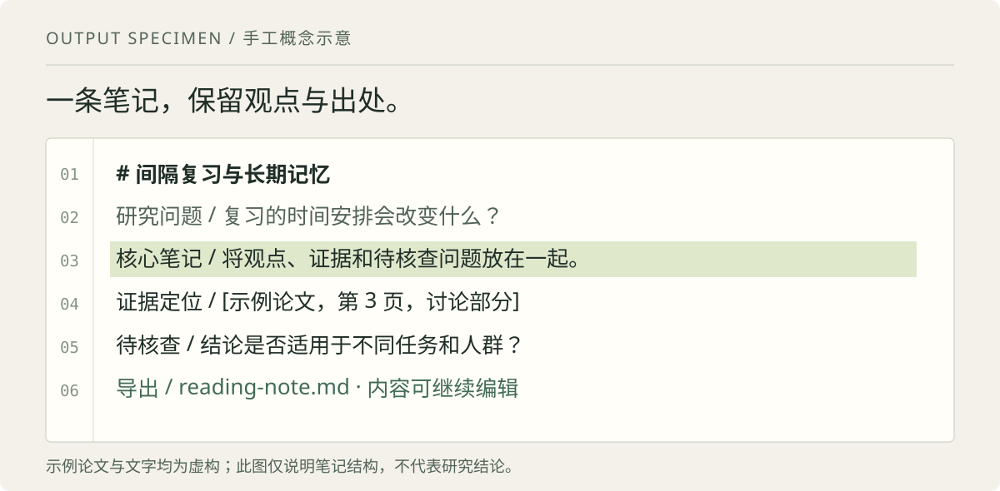

  

# PaperTrail｜论文阅读助手

把论文中的观点、证据位置和待核查问题整理成可继续编辑的 Markdown 笔记。

> **概念演示项目**：本目录展示 README 的设计效果，没有可运行的论文解析或 AI 服务，也没有安装包。下面是手工绘制的概念示意，不是真实产品截图。

## 先看一份笔记

打开 [示例 Markdown 笔记](./examples/reading-note.md)，查看如何将观点和出处放在一起。所有示例论文及文字均为虚构，不代表研究结论。

- **保留上下文**：记录研究问题与核心观点。
- **找到原文**：为笔记附上页码和章节位置。
- **继续思考**：把尚未确认的疑问留在笔记里。

## 设想中的阅读流程

1. **导入论文**：选择希望阅读的文献。
2. **整理笔记**：记录观点、证据位置与待核查问题。
3. **导出 Markdown**：保存笔记，在熟悉的编辑器中继续整理。

这是产品设想，尚未实现以上功能。本案例交付的是说明文档与视觉素材。

## 从这里开始

无需安装。下载本案例文件后，用文本编辑器打开 `examples/reading-note.md`，或打开 `preview.html` 查看美化后的排版。

## 使用边界

- 示例内容只解释笔记结构，不提供科学证据。
- 论文解析、自动摘要和引用核验未实现。
- 实际研究中，请回到原文核查引用及其适用条件。
